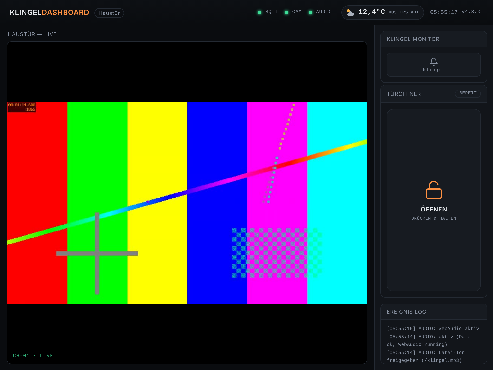

# Klingel-Dashboard Brume 2

**Version 4.3.0** · Klingel-Dashboard mit Kamerabild und MQTT-Türöffner für den
**GL.iNet Brume 2 (GL-MT2500)**, angezeigt dauerhaft auf zwei iPads.



*Dashboard 1 im Querformat (1024×768) – hier mit Testbild statt echter Kamera; oben rechts die Außentemperatur.*

---

## Was es kann

| | |
|---|---|
| **Zwei Dashboards** | Port **8081** und **8082**, gleiche Oberfläche, je ein eigener Titel |
| **Kamerabild** | ein RTSP-Stream für beide Seiten – ffmpeg auf der Brume wandelt ihn einmal in MJPEG um |
| **Klingel** | je Dashboard **ein eigenes MQTT-Topic**; Klingel-Symbol leuchtet, Klingelton im Browser |
| **Außentemperatur** | aktuelle Temperatur mit Wettersymbol in der Kopfzeile – Daten von open-meteo.com, ohne API-Schlüssel |
| **Türöffner** | „Drücken & Halten“ – beide Seiten senden denselben Befehl an denselben Broker, beim Loslassen den Loslassen-Befehl |
| **Einrichtung** | Port **8083**: Broker, Öffner, Kamera (mit Test und Vorschau), Ports, Topics, Passwort |
| **Autostart** | läuft als Dienst auf der Brume und startet nach Stromausfall oder Absturz von selbst |
| **Ein Ordner** | alles liegt in `/root/Klingel-Dashboard` |

Nur Python-Standardbibliothek – keine zusätzlichen Python-Pakete nötig.

## Installation

1. `klingel-dashboard-brume2_v4.3.0.sh` per WinSCP oder `scp -O` nach `/root/` auf die Brume kopieren.
2. Per SSH als `root` ausführen:
   ```
   sh /root/klingel-dashboard-brume2_v4.3.0.sh
   ```
3. Einrichtung öffnen: `http://<IP-der-Brume>:8083`
   → Broker, Öffner-Topics, Kamera-URL und Ort für die Außentemperatur eintragen → **Kamera mit diesen Werten testen** → **Speichern & Neustart**.

Der Installer installiert bei Bedarf `python3`, lädt ein statisches **ffmpeg mit H.264**
(das OpenWrt-Paket kann kein H.264), richtet den Autostart ein und gibt die Ports in der
Firewall frei. Ein Update funktioniert genauso; die `config.ini` bleibt erhalten.

## Auf den iPads

1. `http://<IP-der-Brume>:8081` bzw. `:8082` in Safari öffnen → Teilen → **Zum Home-Bildschirm**.
2. Automatische Sperre auf **Nie**, iPad am Netzteil, optional **Geführter Zugriff**.
3. Nach dem Öffnen einmal auf **„Klingelton einschalten“** tippen – Safari erlaubt Ton erst
   nach einer Berührung. Der Punkt **AUDIO** wird grün.

## Ordner auf der Brume

```
/root/Klingel-Dashboard/
├── klingel_server.py      Programm
├── config.ini             Einstellungen (lesbar)
├── web/                   Dashboard- und Einrichtungsseite
├── bin/ffmpeg             ffmpeg mit H.264/H.265
├── logs/klingel.log       Betriebsprotokoll (auch Audio-Meldungen der iPads)
├── files/                 Autostart-Skript
└── paket/                 Installationspaket
```

| Befehl | Wirkung |
|---|---|
| `/etc/init.d/klingel-dashboard restart` | Dienst neu starten |
| `tail -f /root/Klingel-Dashboard/logs/klingel.log` | Protokoll ansehen |
| `sh /root/Klingel-Dashboard/uninstall.sh --alles` | vollständig entfernen |

## Weitere Informationen

Ausführliche Anleitung mit Kamera-Tipps, Fehlermeldungen, HTTP-Schnittstelle und
Versionsverlauf: **[ANLEITUNG.md](ANLEITUNG.md)**
